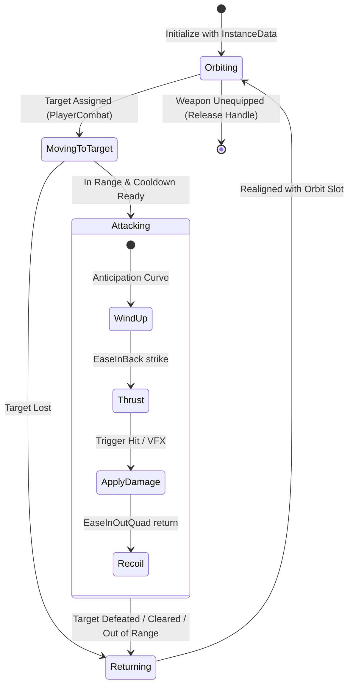
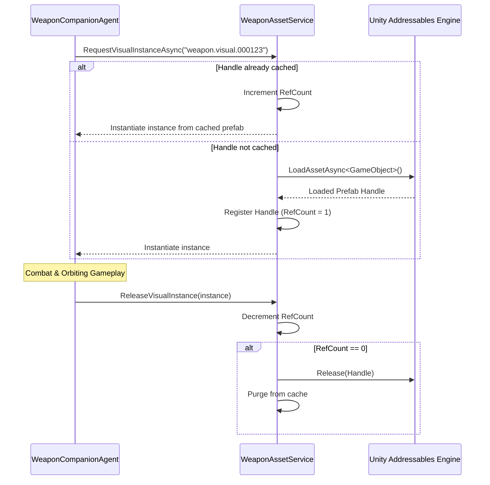

# Monster Quest Simulator ⚔️🐉
> **Next-Gen 3D Action RPG & Companion Weapon Simulator developed in Unity 6 (Universal Render Pipeline)**

[](https://unity.com/)
[](https://unity.com/features/srp/universal-render-pipeline)
[-green?style=for-the-badge)]()
[](https://unity.com/products/netcode)
[](https://unity.com/features/addressables)
[]()

---


## 🌟 Executive Summary

**Monster Quest Simulator** is a high-performance 3D Action RPG & Simulator inspired by *Weapon Fighting Simulator* and modern top-grossing simulator mechanics. The player commands an arsenal of autonomous floating companion weapons that orbit in dynamic geometric formations (Atom Orbit Kinematics) and execute cinematic mathematical thrusts and recoils against enemy swarms.

Engineered with an enterprise-grade **Service-Oriented Architecture (SOA)** in **Unity 6**, the project solves the classic memory, performance, and scaling bottlenecks of massive simulator games:
- 🚀 **Zero-allocation runtime combat** with mathematical easing instead of heavy physics/animators.
- 📦 **Reference-counted Addressables pipeline** preventing asset duplication across hundreds of unique weapons.
- 🖼️ **Virtualized UI grid** with asynchronous LRU-cached texture streaming and stale request cancellation.
- 🌐 **Multiplayer-ready foundation** integrated with Unity Netcode for GameObjects.

---

## 📸 Visual Showcase & Feature Highlights

### 1. Autonomous Weapon Companion System
Floating companion weapons calculate dynamic radial and vertical harmonic orbits around the player character, adjusting in real time from 1 to 15+ weapons simultaneously.

<p align="center">
  
  
</p>

* **Harmonic Orbit Math**: Realtime calculation $x = r \cdot \cos(\theta)$, $y = A \cdot \sin(2\theta + \phi)$, $z = r \cdot \sin(\theta)$ provides fluid, organic floating.
* **Trail Rendering & Lighting**: Dynamic emission ribbons and custom shaders communicate kinetic speed.
* **Organic Easing**: Dual-stage motion curves (`EaseInBack` for anticipation and striking thrust, `EaseInOutQuad` for smooth return to orbit).

---

### 2. Swarm Combat & Dual-Target Lock-On
Players can target primary enemies and queue secondary targets. Weapons dynamically dispatch from orbit to engage, splitting and prioritizing targets automatically.

<p align="center">
  
</p>

* **URP Decal Projectors**: Ground telegraphing with deep vertical projections for instant visual response across uneven terrain (Green = Primary Target, Orange = Queued Target).
* **Decoupled Combat Logic**: Targets remain locked regardless of camera distance, auto-returning to orbit upon target death or command revocation.
* **Multi-Hit Entity System**: Reactive Squash & Stretch hit feedback on monsters (`HitEffectRoutine`) with kinetic damage number indicators.

---

### 3. Virtualized Inventory & Interactive 3D Turntable Preview
High-density inventory management designed to comfortably handle hundreds of unique weapon instances with zero frame drops.

<p align="center">
  
</p>

* **Interactive 3D Turntable**: Dedicated render camera on an isolated layer (`WeaponPreview`) projecting to a `RenderTexture` with smooth touch/drag rotational inspection.
* **LRU Memory-Bounded Icon Cache**: Prevents memory bloat by dynamically loading and evicting icons based on visible viewport cells.
* **Stale Request Guard**: `CancellationTokenSource` and request versioning protect against fast-scrolling UI race conditions.

---

### 4. Massive Arsenal & Data-Driven Catalog
Over 100+ low-poly weapon models classified by rarity, orientation, base damage, and scaling coefficients.

<p align="center">
  
</p>

* **JSON Schema Catalog**: Decoupled from Unity scenes via `IWeaponCatalogSource` and `WeaponCatalogService`.
* **Unique Instance Tracking**: Every weapon dropped or acquired receives a unique GUID (`WeaponInstanceData`), tracking enhancement levels, sell values, and stats independently.

---

### 5. In-Engine Developer Tooling & Live Calibration
Built-in debugging overlays and custom Unity Editor tools for rapid level and weapon authoring.

<p align="center">
  
</p>

* **Runtime Calibration GUI**: Fine-tune position offsets ($X, Y, Z$) and rotational angles in real time per weapon category.
* **Persistent Prefab Synchronization**: Automatically retains intrinsic prefab transforms without destroying artist calibrations.

---

### 6. Rich Low-Poly Environments & World Design
Modular low-poly world structure designed for seamless expansion across themed biomes.

<p align="center">
  
</p>

---

## 🏗️ Technical Architecture

The codebase follows strict separation of concerns, decoupling visual representation, gameplay simulation, and data persistence.

```
                              ┌──────────────────────────┐
                              │     PlayerInput / UI     │
                              └────────────┬─────────────┘
                                           │ Dispatches targets & actions
                                           ▼
┌──────────────────────┐      ┌──────────────────────────┐      ┌──────────────────────────┐
│  WeaponAssetService  │◄─────┤   WeaponCompanionManager ├─────►│WeaponOrbitVisualController│
│ (Addressables + Ref) │      └────────────┬─────────────┘      │  (Dynamic Formations)    │
└──────────────────────┘                   │ Spawns & syncs     └──────────────────────────┘
                                           ▼
                              ┌──────────────────────────┐
                              │   WeaponCompanionAgent   │
                              │ (Finite State Machine)   │
                              └────────────┬─────────────┘
                                           │ Deals damage
                                           ▼
                              ┌──────────────────────────┐
                              │       Enemy Entity       │
                              │(Health, Squash & VFX)    │
                              └──────────────────────────┘
```

### Companion Weapon Finite State Machine
Each active floating weapon is driven by an autonomous `WeaponCompanionAgent` executing a deterministic finite state machine:



### Memory-Safe Addressables Pipeline
To prevent memory exhaustion when dozens of players or weapons coexist:



---

## 📂 Project Structure

```
Monster-Quest-Simulator/
├── Assets/
│   ├── 3D_Assets/              # Low-poly weapon meshes, character rigs, and monster models
│   ├── AddressableAssetsData/  # Addressable group profiles (Weapons, Icons, Materials)
│   ├── Data/                   # Weapon catalog JSONs and item definitions
│   ├── Editor/                 # Custom inspector utilities & batch prefab managers
│   ├── Prefabs/                # NetworkedPlayer, Companion Agents, VFX, and UI Cells
│   ├── Resources/              # Decal projection textures and baseline fallbacks
│   ├── Scenes/
│   │   └── MainLevel.unity     # Primary playable showcase level
│   └── Scripts/
│       ├── Combat/             # Companion Agent FSM, Orbit Controller, Player Combat, Enemy
│       ├── Core/               # GachaPod, Game Loop, Netcode connection helpers
│       ├── Data/               # PlayerData, PlayerInventoryData, Runtime stats calculator
│       ├── Inventory/          # PlayerInventory, PickupItem, LootMagnet physics
│       ├── Player/             # CameraController, PlayerController
│       ├── Services/           # WeaponAssetService, WeaponCatalogService, WeaponPreviewService, IconCacheService
│       ├── UI/                 # Virtualized UI grid, 3D Preview Turntable, HUD, Damage Numbers
│       └── VFX/                # TargetVisuals, URP Decal Projectors, Circle Renderers
├── docs/
│   ├── showcase/               # High-resolution screenshot gallery
│   └── TECHNICAL_PORTFOLIO.md  # Detailed code breakdown & design pattern analysis
└── README.md                   # This document
```

---

## ⚡ Key Technical Achievements

| Dimension | Implementation | Impact |
|---|---|---|
| **Memory Management** | Addressables reference counting + LRU Icon Cache | Zero redundant asset duplicates; unloads textures when outside viewport. |
| **Frame Performance** | Zero per-frame GC allocations in combat loops | Constant 60+ FPS on mobile/WebGL/desktop target specifications. |
| **Motion Kinematics** | Mathematical Lerp & Ease functions (No Animators/PhysX) | Over 50+ simultaneous orbiting weapons with negligible CPU load. |
| **Targeting UX** | URP Decal Projector depth tuning (10m projection volume) | Decals never clip through terrain or disappear during jump/knockback animations. |
| **Architecture** | Interface-driven services (`IWeaponCatalogSource`) | Fully testable without running network backends or loading physical scenes. |

---

## 🎮 Controls & Getting Started

### System Requirements
* **Unity Version**: Unity 6 (`6000.0.57f1` or later recommended).
* **Render Pipeline**: Universal Render Pipeline (URP).
* **Key Packages**: Addressables (`2.x+`), Netcode for GameObjects, Input System, TextMeshPro.

### Quick Start
1. Clone the repository:
   ```bash
   git clone https://github.com/otmexa/Monster-Quest-Simulator.git
   ```
2. Open the project in **Unity Hub** using **Unity 6**.
3. Open the main scene:
   ```
   Assets/Scenes/MainLevel.unity
   ```
4. Press **Play** in the Unity Editor:
   * **Left Click / Touch**: Move player and click on enemies to select (Primary = Green decal, Secondary = Orange decal).
   * **Auto Combat Button**: Toggle companion weapons auto-engagement.
   * **"Armas" (Shop / Inventory)**: Open the virtualized inventory to inspect weapons in 3D and equip companion slots.

---

## 👨‍💻 Author & Contact

This project was built to showcase clean C# game architecture, high-performance visual kinematics, and modular systems design in modern Unity 6.

* **Repository**: [github.com/otmexa/Monster-Quest-Simulator](https://github.com/otmexa/Monster-Quest-Simulator)
* **Lead Developer**: [otmexa](https://github.com/otmexa)
* **Role Focus**: Unity Game Developer / Gameplay & Systems Programmer

---
*Developed with focus on scalability, maintainability, and clean game architecture.*
